# Experiment 4: Cache Coherence and NUMA Memory Access Performance

## 1. Overview

This experiment studies cache coherence protocols, false sharing, and NUMA memory access performance.

It uses a cache coherence simulator and C programs with OpenMP to compare adjacent and padded memory locations, measure memory access times, and observe the effect of local and remote NUMA memory placement.

## 2. Objectives

1. Study MSI, MESI, and MOESI cache coherence protocols.
2. Compare false sharing using adjacent and padded counters.
3. Measure local and remote NUMA memory access performance.
4. Verify correctness and compare execution times.

## 3. System Configuration

| Component | Configuration |
|---|---|
| Virtualization software | VMware Workstation 17.6.4 |
| Operating system | Ubuntu Linux VM |
| Processor reported by VM | Intel Core i9-14900KF |
| Virtual CPU cores | 4 |
| Virtual NUMA nodes | 2 |
| Compiler | GCC 15.2.0 |
| Python | 3.14.4 |
| OpenMP | Supported |
| NUMA management | numactl |
| Cache line size used for padding | 64 bytes |

### NUMA topology

The virtual machine exposes two NUMA nodes.

| Property | NUMA Node 0 | NUMA Node 1 |
|---|---:|---:|
| CPUs | 0, 1 | 2, 3 |
| Memory size | 2014 MB | 1389 MB |

NUMA distance matrix:

| From / To | Node 0 | Node 1 |
|---|---:|---:|
| Node 0 | 10 | 20 |
| Node 1 | 20 | 10 |

A distance of 10 represents local access, while 20 represents remote access according to the virtual NUMA topology.

**Note:** The NUMA nodes are virtualized by VMware. The underlying host has one physical CPU package, so these results should not be interpreted as a comparison between two separate physical NUMA sockets.

## 4. Files Used

| File | Description |
|---|---|
| `coherence_sim.py` | Simulates MSI, MESI, and MOESI cache coherence protocols. |
| `false_sharing.c` | Compares adjacent and padded counters using OpenMP. |
| `numa_sweep.c` | Measures memory access performance using NUMA memory placement. |
| `compare_numa.c` | Performs false-sharing and 512 MB memory-sweep comparisons. |
| `false_sharing` | Compiled false-sharing executable. |
| `numa_sweep` | Compiled NUMA sweep executable. |
| `compare_numa` | Compiled comparison executable. |
| `results/` | Stores experiment outputs and measurements. |

## 5. Experiment 1: Cache Coherence Simulation

### Description

Cache coherence ensures that multiple processor cores maintain a consistent view of shared memory.

The simulator compares three protocols:

- **MSI:** Uses Modified, Shared, and Invalid states.
- **MESI:** Adds the Exclusive state to MSI.
- **MOESI:** Adds the Owned state to MESI.

The simulation uses two cores and 1000 iterations. It compares adjacent and padded memory layouts.

### Command

```bash
python3 coherence_sim.py 1000 | tee results/coherence_results.txt
```

### Adjacent layout results

| Protocol | Bus Transactions | BusRd | BusRdX | BusUpgr | Invalidations | Write-backs | Cache-to-cache | Silent E→M |
|---|---:|---:|---:|---:|---:|---:|---:|---:|
| MSI | 4000 | 2000 | 0 | 2000 | 1999 | 1999 | 0 | 0 |
| MESI | 3999 | 2000 | 0 | 1999 | 1999 | 1999 | 0 | 1 |
| MOESI | 3999 | 2000 | 0 | 1999 | 1999 | 0 | 1999 | 1 |

### Padded layout results

| Protocol | Bus Transactions | BusRd | BusRdX | BusUpgr | Invalidations | Write-backs | Cache-to-cache | Silent E→M |
|---|---:|---:|---:|---:|---:|---:|---:|---:|
| MSI | 4 | 2 | 0 | 2 | 0 | 0 | 0 | 0 |
| MESI | 2 | 2 | 0 | 0 | 0 | 0 | 0 | 2 |
| MOESI | 2 | 2 | 0 | 0 | 0 | 0 | 0 | 2 |

### Observation

The adjacent layout generates a large number of coherence transactions because both cores access data located in the same simulated cache line.

The padded layout separates the data into different cache lines. This significantly reduces bus transactions and invalidations.

MESI can use the Exclusive state when a core has the only cached copy. MOESI can use the Owned state to allow a modified cache line to be shared without immediately writing it back to memory.

These values are results from the software simulator, not measurements of physical hardware cache protocol transitions.

## 6. Experiment 2: False Sharing

### Description

False sharing occurs when different processor cores update different variables that happen to occupy the same cache line.

Although the variables are independent, cache coherence operates at cache-line granularity.

Two layouts were tested:

- **Adjacent:** Counters are stored next to each other using stride 1.
- **Padded:** Counters use stride 8, separating them by 64 bytes when using 8-byte `long` values.

The program performs 100 million total increments using 1, 2, and 4 OpenMP threads.

### Compilation

```bash
gcc -O2 false_sharing.c -fopenmp -o false_sharing
```

### Execution

```bash
OMP_NUM_THREADS=2 ./false_sharing adjacent
OMP_NUM_THREADS=2 ./false_sharing padded
```

Each configuration was executed three times.

### Recorded results

| Run | Adjacent Time (s) | Padded Time (s) |
|---|---:|---:|
| 1 | 0.0103 | 0.0102 |
| 2 | 0.0097 | 0.0084 |
| 3 | 0.0102 | 0.0086 |
| **Median** | **0.0102** | **0.0086** |

All runs produced a total of 100,000,000 increments.

### Performance comparison

Adjacent-to-padded ratio:

```text
0.0102 / 0.0086 = 1.186
```

Adjacent counters were approximately 18.6% slower than padded counters based on the median execution times.

### Observation

Padding reduces false sharing by separating counters into different cache lines. The measured results show that the padded arrangement performs better in this two-thread test.

## 7. Experiment 3: NUMA Memory Access

### Description

NUMA stands for Non-Uniform Memory Access.

In a NUMA system, a processor can access memory associated with its own NUMA node or memory associated with another node.

- **Local memory:** CPU and memory are assigned to the same NUMA node.
- **Remote memory:** CPU and memory are assigned to different NUMA nodes.

The `numactl` command controls CPU and memory placement.

### Preliminary 32 MB memory sweep

The `numa_sweep` program was first tested using a 32 MB buffer.

Commands:

```bash
OMP_NUM_THREADS=2 numactl --cpunodebind=0 --membind=0 ./numa_sweep 32
```

```bash
OMP_NUM_THREADS=2 numactl --cpunodebind=0 --membind=1 ./numa_sweep 32
```

Recorded results:

| Memory Placement | Buffer Size | Threads | Sum | Time (s) |
|---|---:|---:|---:|---:|
| Local | 32 MB | 2 | 2097152 | 0.0185 |
| Remote | 32 MB | 2 | 2097152 | 0.0026 |

The remote result was faster in this preliminary measurement. This single small-buffer measurement is not sufficient to conclude that remote memory is faster.

## 8. Experiment 4: Comparative False Sharing and NUMA Benchmark

### Description

The `compare_numa.c` program performs two comparisons.

**Table 1: False-sharing comparison**

- Uses 1, 2, and 4 threads.
- Compares adjacent and padded counters.
- Performs 100 million total increments in each configuration.
- Checks the final counter total.

**Table 2: Memory-sweep comparison**

- Allocates a 512 MB memory buffer.
- Initializes the buffer before timing.
- Performs four passes.
- Reads one byte every 64 bytes.
- Compares 1 and 2 threads.
- Checks the expected sum.

### Compilation

```bash
gcc -O2 -fopenmp compare_numa.c -o compare_numa
```

### Default execution

```bash
./compare_numa
```

### Local NUMA execution

```bash
numactl --cpunodebind=0 --membind=0 ./compare_numa
```

### Remote NUMA execution

```bash
numactl --cpunodebind=0 --membind=1 ./compare_numa
```

Each configuration was repeated three times. The median execution time is used for the final comparison.

### 8.1 Default configuration: median results

**False-sharing comparison**

| Threads | Adjacent Time (s) | Padded Time (s) |
|---|---:|---:|
| 1 | 0.0166 | 0.0158 |
| 2 | 0.0098 | 0.0080 |
| 4 | 0.0046 | 0.0041 |

**512 MB memory sweep**

| Threads | Median Time (s) |
|---|---:|
| 1 | 0.0698 |
| 2 | 0.0418 |

### 8.2 Local NUMA configuration: median results

**False-sharing comparison**

| Threads | Adjacent Time (s) | Padded Time (s) |
|---|---:|---:|
| 1 | 0.0166 | 0.0161 |
| 2 | 0.0097 | 0.0081 |
| 4 | 0.0106 | 0.0081 |

**512 MB memory sweep**

| Threads | Median Time (s) |
|---|---:|
| 1 | 0.0721 |
| 2 | 0.0432 |

### 8.3 Remote NUMA configuration: median results

**False-sharing comparison**

| Threads | Adjacent Time (s) | Padded Time (s) |
|---|---:|---:|
| 1 | 0.0166 | 0.0162 |
| 2 | 0.0099 | 0.0085 |
| 4 | 0.0104 | 0.0084 |

**512 MB memory sweep**

| Threads | Median Time (s) |
|---|---:|
| 1 | 0.0825 |
| 2 | 0.0457 |

## 9. Combined NUMA Memory-Sweep Results

The following table combines the final median results from all three configurations.

| Configuration | Threads | 512 MB Sweep Time (s) |
|---|---:|---:|
| Default | 1 | 0.0698 |
| Default | 2 | 0.0418 |
| Local | 1 | 0.0721 |
| Local | 2 | 0.0432 |
| Remote | 1 | 0.0825 |
| Remote | 2 | 0.0457 |

### NUMA performance ratios

Remote-to-local ratio:

**One thread**

```text
0.0825 / 0.0721 = 1.144
```

Remote memory was approximately 14.4% slower than local memory.

**Two threads**

```text
0.0457 / 0.0432 = 1.058
```

Remote memory was approximately 5.8% slower than local memory.

### Observation

The final 512 MB results show that local memory was faster than remote memory for both thread configurations.

The difference was more noticeable with one thread than with two threads.

The results are affected by the virtual NUMA environment and should not be treated as universal hardware performance values.

## 10. Experiment 5: Cross-NUMA False Sharing

An additional test was performed by placing two OpenMP threads on CPUs belonging to different virtual NUMA nodes.

Commands:

```bash
OMP_NUM_THREADS=2 taskset -c 0,2 ./false_sharing adjacent
```

```bash
OMP_NUM_THREADS=2 taskset -c 0,2 ./false_sharing padded
```

Recorded results:

| Layout | Threads | Total Increments | Time (s) |
|---|---:|---:|---:|
| Adjacent | 2 | 100000000 | 0.0119 |
| Padded | 2 | 100000000 | 0.0116 |

### Observation

The padded layout was slightly faster in this single cross-NUMA test. The difference is small, and more repetitions would be needed for a stronger conclusion.

## 11. Correctness Verification

The corrected `compare_numa.c` program verifies the counter totals and memory-sweep results.

### Counter verification

| Threads | Adjacent Total | Padded Total | Status |
|---:|---:|---:|---|
| 1 | 100000000 | 100000000 | PASS |
| 2 | 100000000 | 100000000 | PASS |
| 4 | 100000000 | 100000000 | PASS |

### Memory-sweep verification

The expected sum is calculated as:

```text
Expected Sum = 4 × (512 × 1024 × 1024 / 64)
             = 33554432
```

| Threads | Actual Sum | Expected Sum | Status |
|---:|---:|---:|---|
| 1 | 33554432 | 33554432 | PASS |
| 2 | 33554432 | 33554432 | PASS |

All correctness checks passed in the repeated default, local, and remote measurements.

## 12. Performance Analysis

### False sharing

The padded arrangement generally performed better than the adjacent arrangement.

Padding separates independently updated counters into different cache lines. This reduces unnecessary cache-line invalidations and coherence traffic.

### Thread scaling

The default 512 MB memory sweep improved from 0.0698 seconds with one thread to 0.0418 seconds with two threads.

The local NUMA sweep improved from 0.0721 seconds to 0.0432 seconds.

The remote NUMA sweep improved from 0.0825 seconds to 0.0457 seconds.

This shows that using two threads improved the measured memory-sweep execution time in all three configurations.

### NUMA placement

The remote configuration was slower than the local configuration in the final 512 MB median measurements.

However, the virtualized NUMA topology and execution-time variation influence the results. The measurements demonstrate the effect observed in this VM, not a guaranteed performance difference on every physical NUMA machine.


## Screenshots

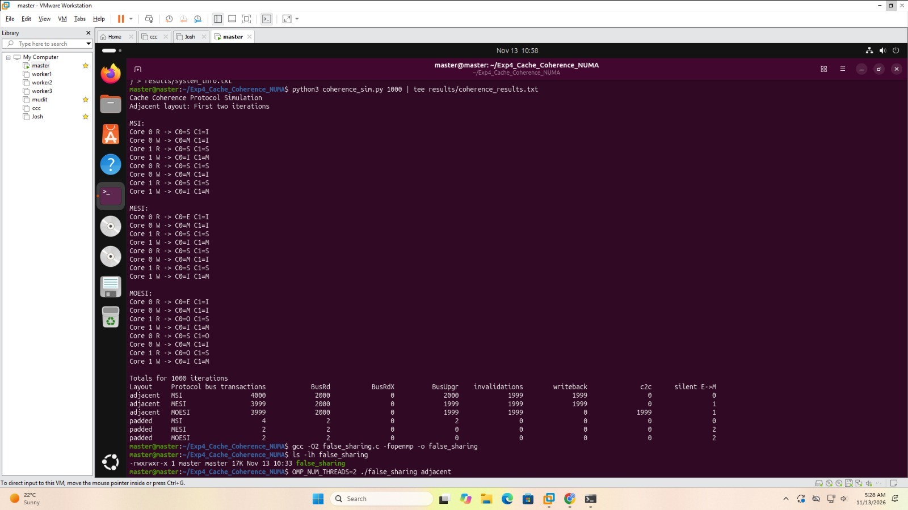

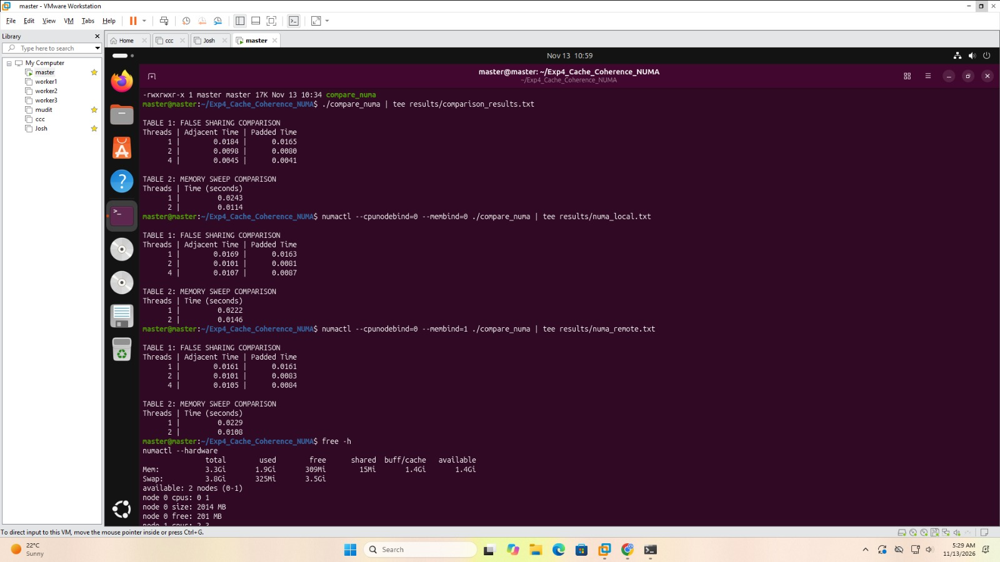
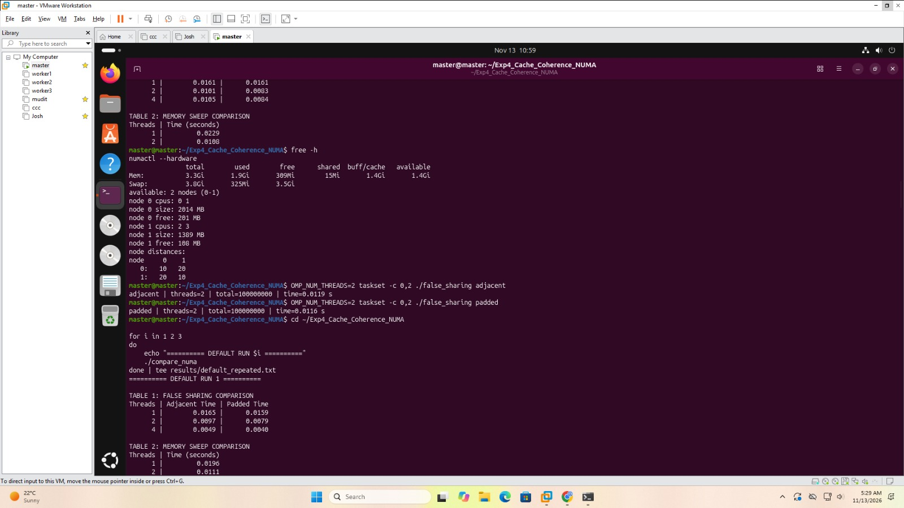
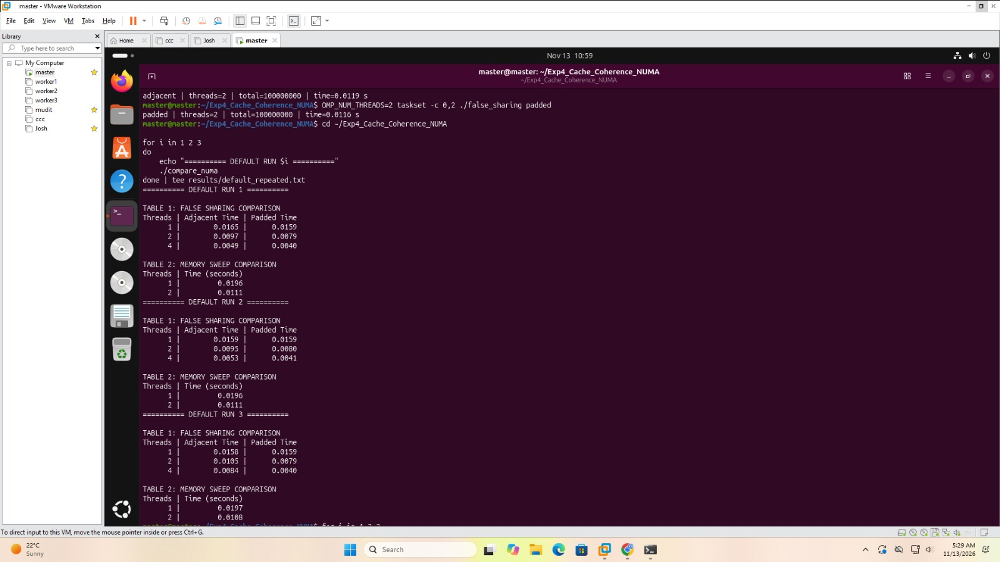
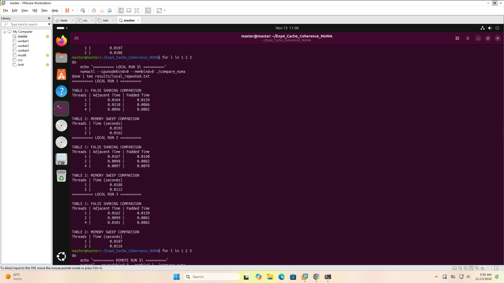

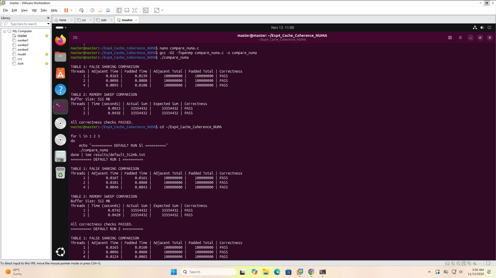
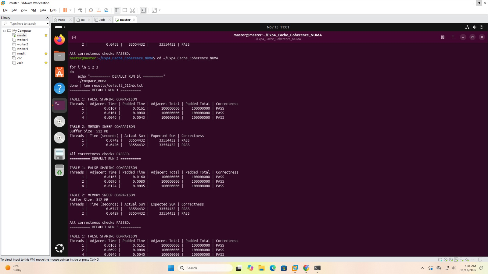
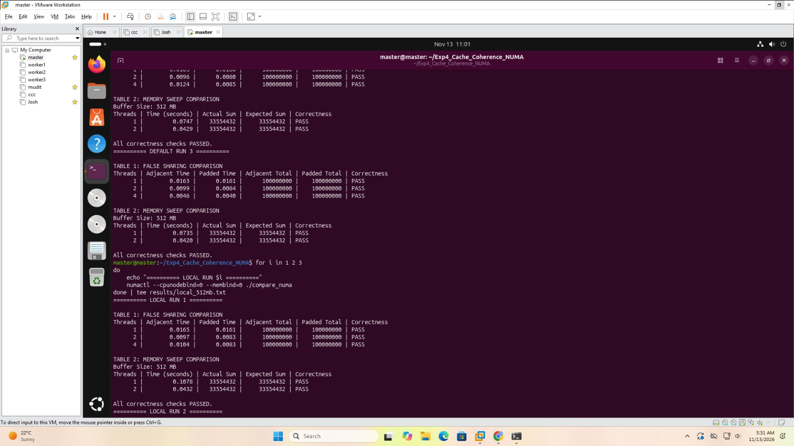
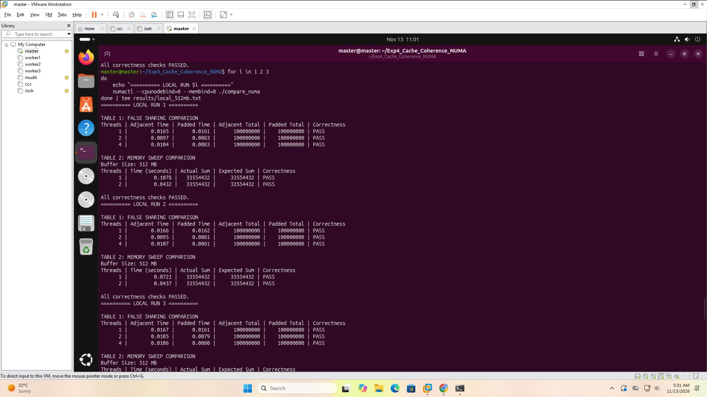
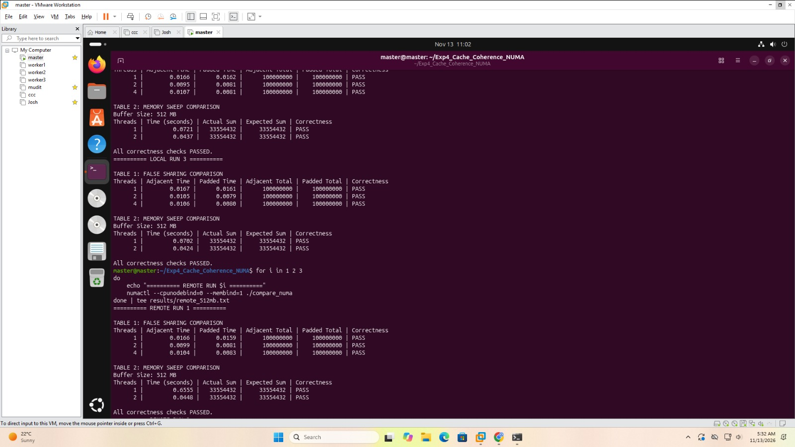
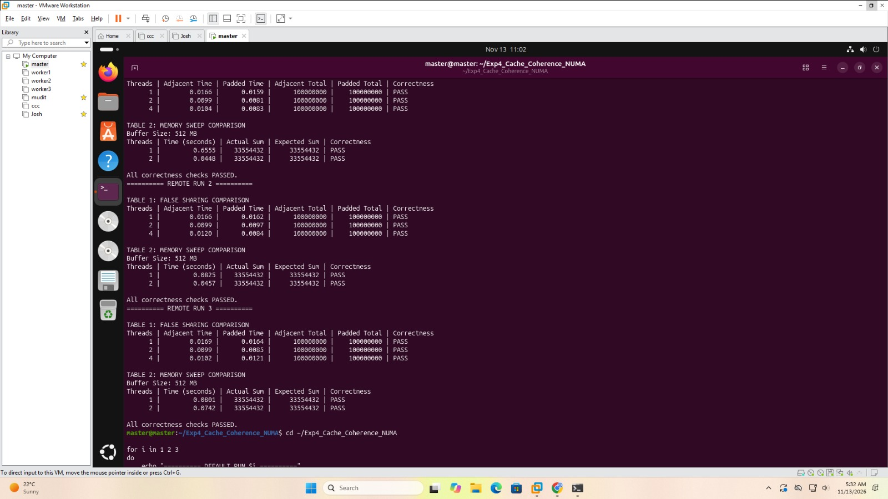
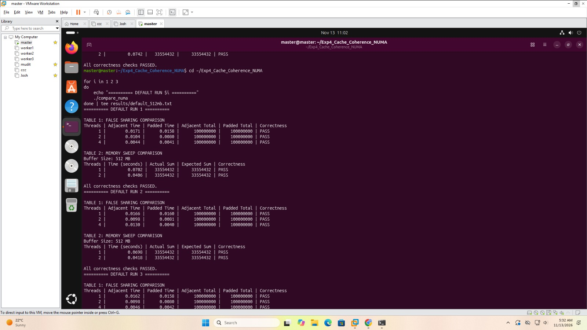
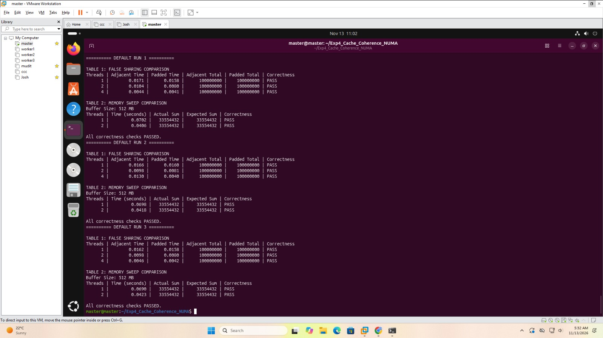
## 13. Conclusion

This experiment demonstrated how cache coherence protocols maintain consistency between processor caches and how false sharing can affect parallel performance.

The MSI, MESI, and MOESI simulator showed that separating data into different cache lines significantly reduces coherence transactions.

The false-sharing experiments showed that padded counters generally performed better than adjacent counters, particularly with multiple threads.

The NUMA memory-sweep experiments showed that local memory was faster than remote memory in the final 512 MB median measurements. Using two threads also reduced the measured memory-sweep execution time.

All counter totals and memory-sweep sums were verified successfully.

Therefore, the experiment successfully demonstrated cache coherence behavior, false sharing, parallel execution, and local versus remote NUMA memory placement.


```


